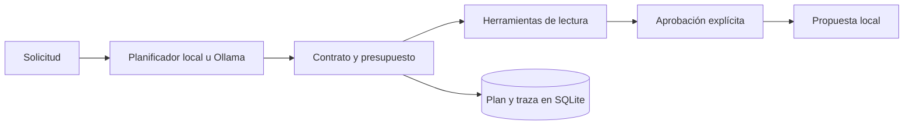

# Arquitectura

El plan se serializa con una huella y se conserva antes de ejecutar pasos. La reanudación consulta ese plan persistido, su posición y su presupuesto consumido. Los parámetros nuevos de la solicitud no reemplazan el plan aprobado.

Las herramientas contienen consultas SQL parametrizadas y filtran por tenant. Sólo `demo` recibe pedidos sintéticos. La propuesta verifica de nuevo la disponibilidad; es un borrador y no reserva inventario.

La política de permisos pertenece al ejecutor. El modelo sólo produce una propuesta de plan. Las acciones de aprobación requieren una operación explícita de API; el contenido de una tarea no puede aprobarse a sí mismo. El token compartido autentica al cliente del servicio y debe reemplazarse por identidad y permisos por usuario para un entorno multiusuario.
