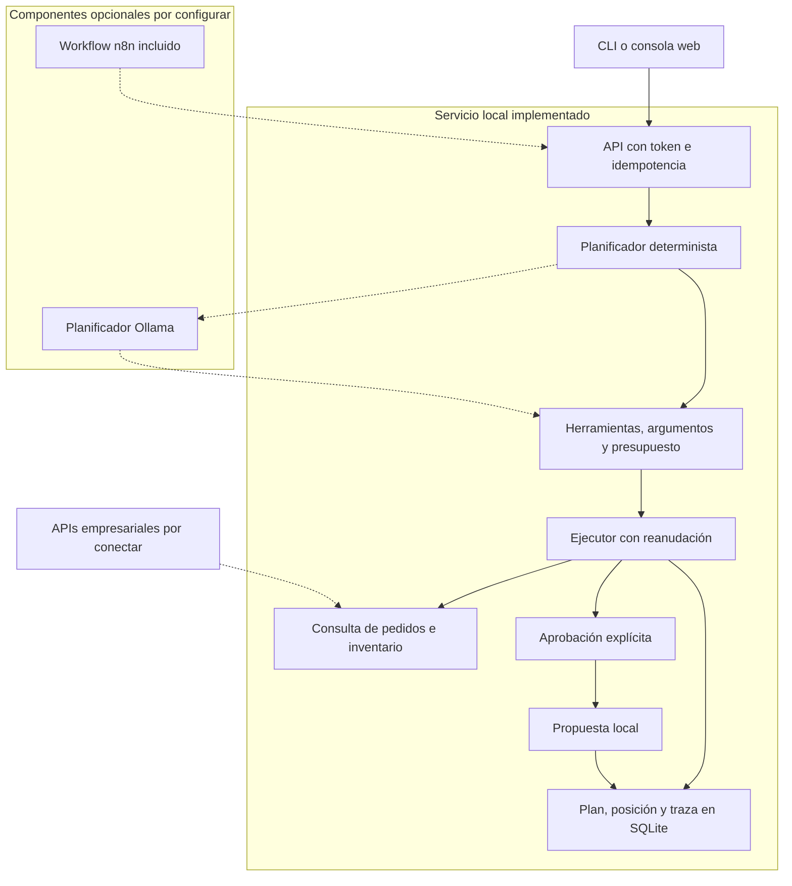

# Arquitectura

[Abrir SVG](diagrams/architecture.svg) · [Fuente Mermaid](diagrams/architecture.mmd)

Un planificador propone herramientas y un ejecutor aplica el contrato, el presupuesto y las aprobaciones. La persistencia permite reanudar el mismo plan sin repetir una propuesta completada.

Versión Mermaid

Las líneas continuas muestran el recorrido implementado dentro de cada límite. Las líneas discontinuas indican componentes opcionales, entregados para configurar o aún por conectar; su estado se precisa en [tecnologías](technologies.md).

El plan se serializa con una huella y se conserva antes de ejecutar pasos. La reanudación consulta ese plan persistido, su posición y su presupuesto consumido. Los parámetros nuevos de la solicitud no reemplazan el plan aprobado.

Las herramientas contienen consultas SQL parametrizadas y filtran por tenant. Sólo `demo` recibe pedidos sintéticos. La propuesta verifica de nuevo la disponibilidad; es un borrador y no reserva inventario.

La política de permisos pertenece al ejecutor. El modelo sólo produce una propuesta de plan. Las acciones de aprobación requieren una operación explícita de API; el contenido de una tarea no puede aprobarse a sí mismo. El token compartido autentica al cliente del servicio y debe reemplazarse por identidad y permisos por usuario para un entorno multiusuario.

[Flujo de operación](flow.md) · [Tecnologías y alcance](technologies.md)
