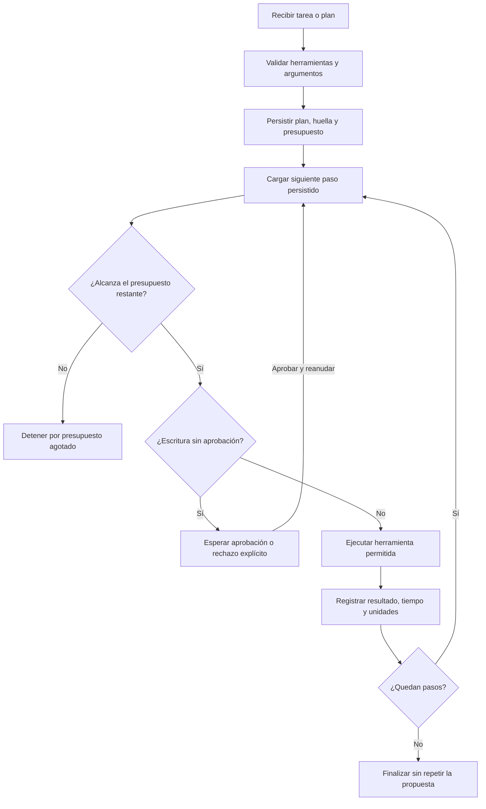

# Flujo de operación

[Abrir SVG](diagrams/flow.svg) · [Fuente Mermaid](diagrams/flow.mmd)

Versión Mermaid

- El plan admite hasta seis pasos y una única escritura al final. El modelo no define permisos del ejecutor.
- La reanudación utiliza plan y posición guardados; no reinicia unidades consumidas ni sustituye el plan por parámetros nuevos.
- `proposal.create` comprueba existencias y crea sólo un borrador local. No reserva ni modifica inventario.

Las operaciones del dominio se guardan junto a auditoría y respuesta idempotente en la transacción del servicio local. Un error revierte los cambios de esa solicitud.

[Arquitectura](architecture.md) · [Tecnologías y alcance](technologies.md)
